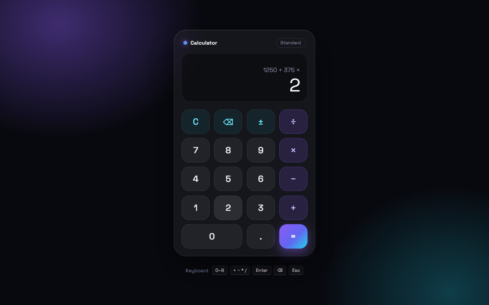
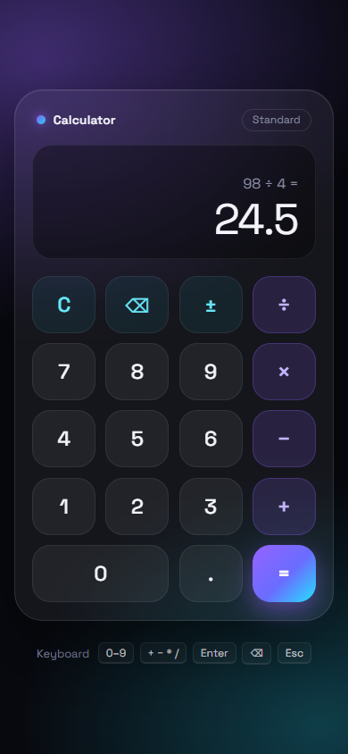

# Calculator

A browser-based calculator built with **HTML5, CSS3 and vanilla JavaScript**. It handles chained operations with correct maths precedence, and it does this without `eval()`.

**Oasis Infobyte Internship · Web Development & Designing · Level 2, Task 1**

🔗 **Live demo:** https://sidragithb.github.io/OIBSIP/WebDev-L2-Calculator/

| Desktop | Mobile |
| --- | --- |
|  |  |

## Features

- [x] Display screen showing the current input and the result, with the full expression above it
- [x] Number buttons 0–9 and a decimal point (only one decimal point is allowed per number)
- [x] Operators: addition (+), subtraction (−), multiplication (×) and division (÷)
- [x] Equals (=), Clear (C) and Backspace (⌫) buttons
- [x] Division by zero shows **"Cannot divide by zero"** instead of crashing
- [x] Operator chaining: `5 + 3 × 2 = 11` (× and ÷ are done before + and −), and you can keep calculating from a result
- [x] Pressing a second operator replaces the first, e.g. `5 + ×` becomes `5 ×`
- [x] **CSS Grid** button layout
- [x] Event listeners on every button, with **no inline `onclick`**
- [x] Extras: ± sign toggle, keyboard support, floating-point fix (`0.1 + 0.2` shows `0.3`) and a responsive layout
- [x] "Aurora glass" design: a frosted-glass card (`backdrop-filter`) over violet and cyan glows, with the Space Grotesk font

## Tech stack

HTML5 · CSS3 (Grid, custom properties) · JavaScript (ES6, no libraries)

## How to run

Open `index.html` in any modern browser, or use the live demo link above.

## How it works

1. **State.** The expression is kept as an array of tokens, such as `["5", "+", "3", "×"]`, along with the number currently being typed (`current`).
2. **Input.** Each button has a `data-digit`, `data-operator` or `data-action` attribute. One `addEventListener("click")` per button sends it to `handleButton()`, which uses a `switch` to call the right function.
3. **Evaluation without eval().** `evaluate()` goes through the tokens once. It applies × and ÷ straight away and puts + and − numbers on a stack. Then it adds the stack up. This is how `5 + 3 × 2` correctly gives `11`.
4. **Errors.** Dividing by zero throws an error. The calculator catches it and shows the message on the display. The next key press starts a fresh calculation.
5. **Rounding.** Results are rounded with `toPrecision(12)` to remove floating-point noise.

## Keyboard shortcuts

| Key | Action |
| --- | --- |
| `0`–`9`, `.` | Enter a number |
| `+` `-` `*` `/` | Operators |
| `Enter` or `=` | Equals |
| `Backspace` | Delete the last character |
| `Esc` or `Delete` | Clear |

## Project structure

```
WebDev-L2-Calculator/
├── index.html      # markup and buttons
├── style.css       # layout (CSS Grid) and theme
├── script.js       # calculator logic and event listeners
└── screenshots/
```

---
Made by **Sidra Kousar** for the Oasis Infobyte Internship Program.
