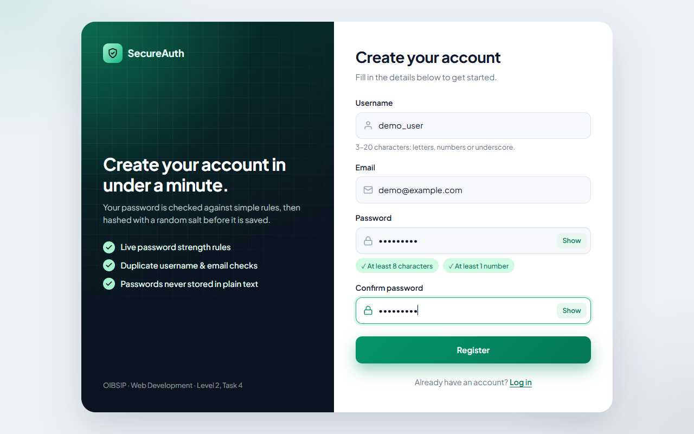
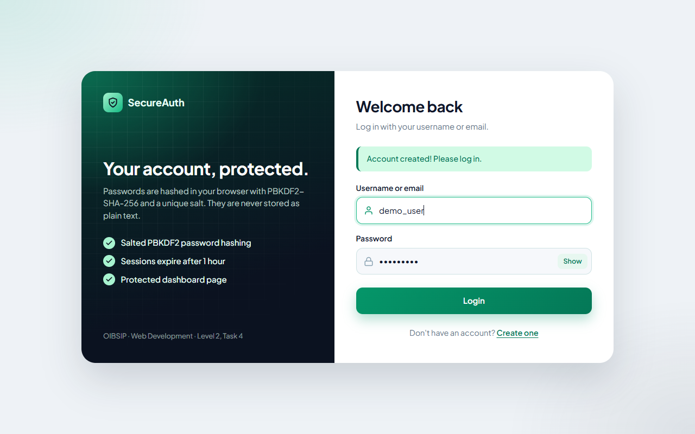
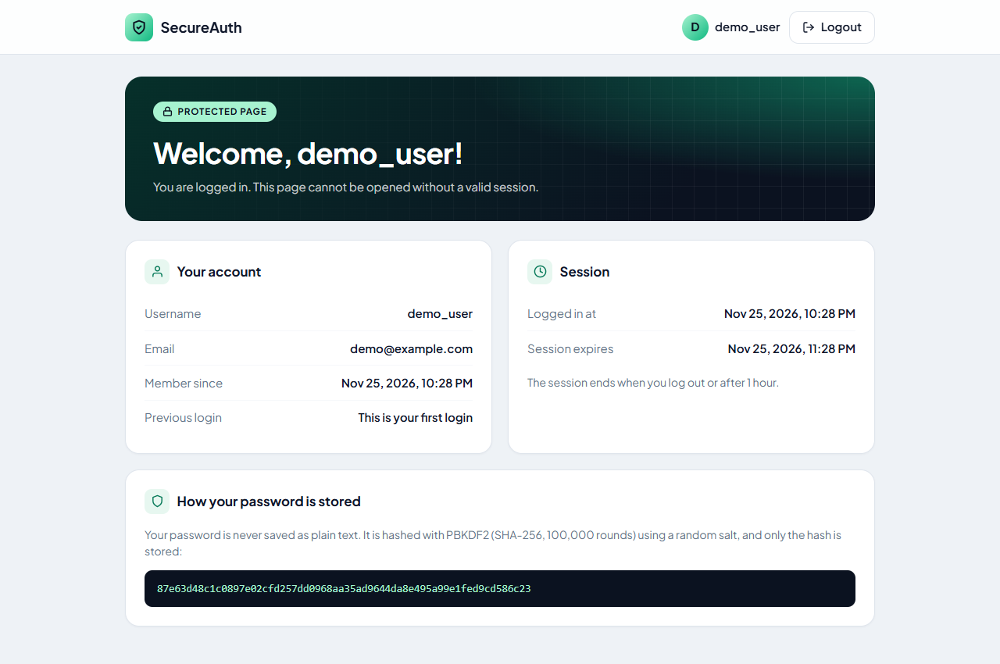

# Login Authentication System

A client-side authentication system with registration, login, a protected dashboard and logout. Passwords are **hashed with PBKDF2-SHA-256 and a random salt**; they are never stored as plain text. Built with **HTML5, CSS3 and vanilla JavaScript**, using `localStorage` and the browser's Web Crypto API.

**Oasis Infobyte Internship · Web Development & Designing · Level 2, Task 4**
Approach chosen: **(A) Front-end only: HTML/CSS/JavaScript with localStorage**

🔗 **Live demo:** https://sidragithb.github.io/OIBSIP/WebDev-L2-LoginAuth/

| Register | Login | Dashboard |
| --- | --- | --- |
|  |  |  |

## Features

- [x] **Registration page** with username, email, password and confirm-password fields
- [x] **Password rules:** at least 8 characters and at least 1 number, with a live checklist that turns green
- [x] **Duplicate check:** an error if the username or email is already registered (not case-sensitive)
- [x] **Login page:** log in with either the username or the email, plus the password
- [x] **Wrong credentials:** the same message, *"Invalid username/email or password."*, for a wrong username or a wrong password, so the page never reveals which one was wrong
- [x] **Protected dashboard:** opening `dashboard.html` without a valid session redirects to the login page
- [x] **Logout** clears the session and redirects to the login page
- [x] **Hashed passwords:** PBKDF2 with SHA-256, 100,000 iterations and a unique 16-byte salt per user
- [x] **Form validation** on both pages: no empty submissions, valid email format, matching passwords
- [x] Extras: sessions expire after 1 hour, show/hide password buttons, the "Back" button can't reopen the dashboard after logout, logging out in one tab logs out other tabs, and a responsive design
- [x] Professional split-screen design: a dark brand panel beside the form, icons inside the input fields, and a dashboard with a user avatar

## Tech stack

HTML5 · CSS3 · JavaScript (ES6, `async`/`await`) · Web Crypto API (`crypto.subtle`) · `localStorage`

## How to run

Open `index.html` in a browser, or use the live demo link above.

> The Web Crypto API needs a *secure context*. This includes `https://` (GitHub Pages), `http://localhost` (for example VS Code Live Server) and local files opened in Chrome or Edge.

### Try it

1. Click **Create one**, then register (for example `demo_user` / `demo@example.com` / `Oasis2026`).
2. Try registering the same username again to see the duplicate error.
3. Log in with a wrong password to see the generic error, then log in correctly.
4. Log out, then open `dashboard.html` directly. You'll be sent back to the login page.

## How it works

| File | Role |
| --- | --- |
| `auth.js` | Shared logic: user storage, password hashing, login/logout and session checks |
| `register.js` | Validates the form, checks for duplicates and saves the new user |
| `login.js` | Validates the form and checks credentials, then creates a session |
| `dashboard.js` | Runs in `<head>` and redirects to login **before** the page is shown if there is no valid session |

**Registration:** a random salt is generated, and `PBKDF2(password, salt)` produces a 256-bit hash. Only `{ username, email, salt, passwordHash }` is saved.

**Login:** the user is found by username or email, and the entered password is hashed with that user's salt. If the two hashes match, a session `{ username, loginAt, expiresAt }` is saved. If the user doesn't exist, the password is still hashed, so both kinds of failure take the same time and give the same message.

**Protected page:** `Auth.getSession()` returns `null` if there is no session, the session has expired, or the user no longer exists. In that case `dashboard.js` calls `location.replace("index.html")`.

> ⚠️ This is a learning project. Everything runs in the browser, so anyone with access to the device can edit `localStorage`. A production system would check passwords on a server, for example with Node.js, Express and bcrypt, and use secure HTTP-only cookies.

## Project structure

```
WebDev-L2-LoginAuth/
├── index.html       # login page
├── register.html    # registration page
├── dashboard.html   # protected page
├── auth.js          # shared auth logic
├── login.js
├── register.js
├── dashboard.js
├── style.css
└── screenshots/
```

---
Made by **Sidra Kousar** for the Oasis Infobyte Internship Program.
