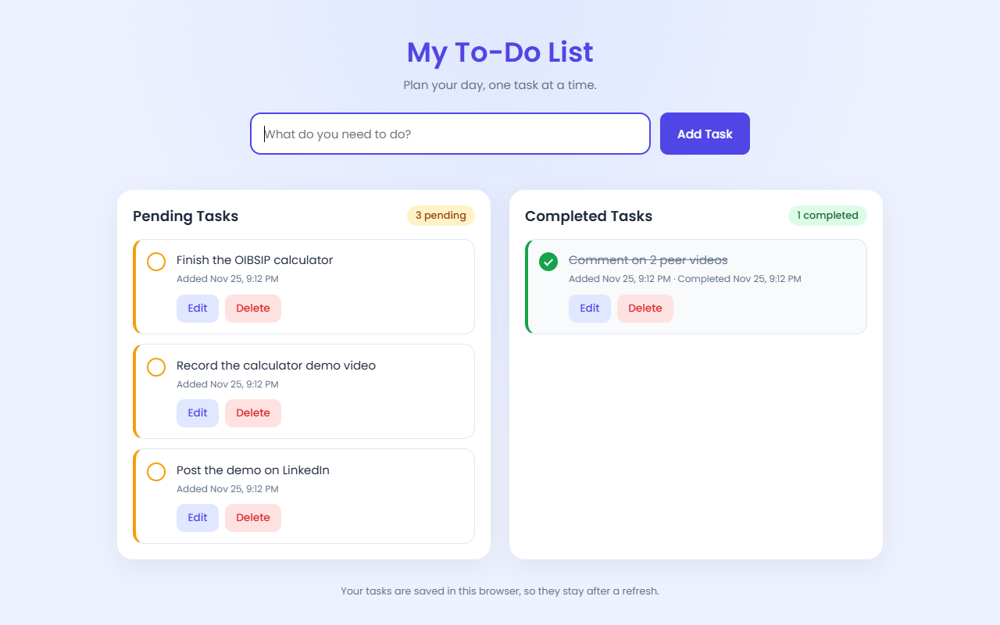
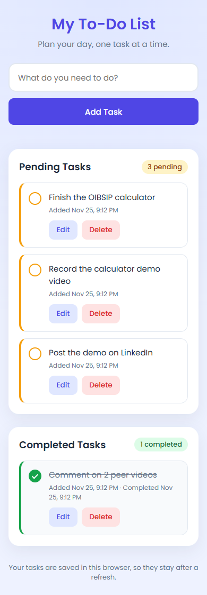

# To-Do Web App

An interactive to-do list with **Pending** and **Completed** lists, inline editing, timestamps and `localStorage` persistence. Built with **HTML5, CSS3 and vanilla JavaScript**.

**Oasis Infobyte Internship · Web Development & Designing · Level 2, Task 3**

🔗 **Live demo:** https://sidragithb.github.io/OIBSIP/WebDev-L2-TodoApp/

| Desktop | Mobile |
| --- | --- |
|  |  |

## Features

- [x] Input field and an **Add Task** button (pressing Enter also works; empty tasks are rejected with a message)
- [x] New tasks appear in the **Pending Tasks** list immediately
- [x] A **Mark Complete** toggle moves a task to **Completed Tasks**; clicking it again moves the task back
- [x] **Edit** turns the task text into an input box (Save / Cancel, Enter / Esc)
- [x] **Delete** removes a task from either list
- [x] Counters: **"X pending"** and **"Y completed"**
- [x] Empty-state messages when a list has no tasks
- [x] **Bonus:** timestamps showing when each task was added and completed
- [x] **Bonus:** tasks are saved in `localStorage` and survive a page refresh
- [x] Responsive: two lists side by side on desktop, stacked on mobile

## Tech stack

HTML5 · CSS3 (Grid, Flexbox, custom properties) · JavaScript (ES6, DOM API, `localStorage`, `Intl.DateTimeFormat`)

## How to run

Open `index.html` in a browser, or use the live demo link above.

## How it works

1. **One source of truth.** All tasks live in an array of objects:
   `{ id, text, completed, createdAt, completedAt }`.
2. **Every action follows the same pattern:** update the array → `saveTasks()` writes it to `localStorage` → `render()` redraws both lists from the array.
3. **Rendering** builds each task with `document.createElement` and `textContent`. User text is never inserted as HTML, so typing `<b>hi</b>` shows the literal text instead of injecting markup.
4. **Event delegation.** Each list has one click listener. It reads the button's `data-action` (`toggle`, `edit`, `save`, `cancel` or `delete`) and its `data-id`.
5. **Editing.** `editingId` stores which task is being edited. `render()` shows an input box for that task instead of its text.

## Project structure

```
WebDev-L2-TodoApp/
├── index.html
├── style.css
├── script.js
└── screenshots/
```

---
Made by **Sidra Kousar** for the Oasis Infobyte Internship Program.
