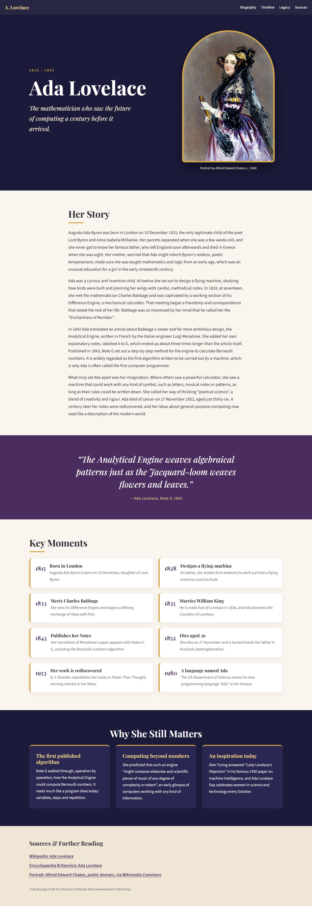
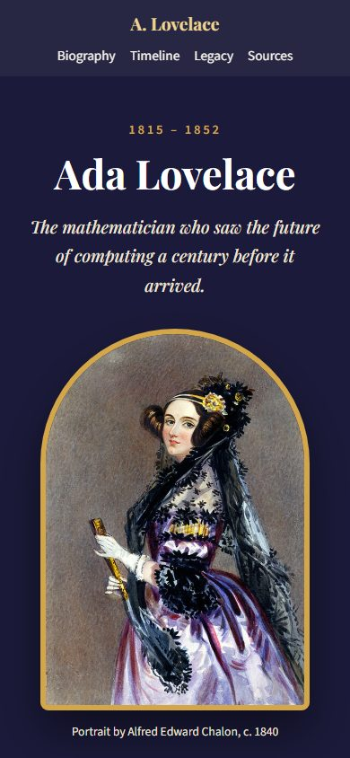

# Tribute Page: Ada Lovelace

A responsive tribute page to **Ada Lovelace** (1815–1852), the mathematician who wrote the first published algorithm intended for a machine. Built with **HTML5 and CSS3**.

**Oasis Infobyte Internship · Web Development & Designing · Level 2, Task 2**

🔗 **Live demo:** https://sidragithb.github.io/OIBSIP/WebDev-L2-TributePage/

| Desktop (full page) | Mobile |
| --- | --- |
|  |  |

## Features

- [x] Page title with the subject's name and a one-line tagline
- [x] A prominent, royalty-free image: a public-domain portrait from Wikimedia Commons, with a caption and credit
- [x] A biography section with 4 paragraphs of original writing
- [x] A key-moments timeline as an ordered list of styled cards (1815 → 1980)
- [x] A quote block from Ada's 1843 *Note A*, styled on its own background
- [x] 4 background colours: navy, cream, plum and sand
- [x] 2 font styles: **Playfair Display** (serif) for headings and **Source Sans 3** (sans-serif) for body text, from Google Fonts
- [x] Responsive layout: two columns become one column on tablets and phones
- [x] Extras: sticky navigation with smooth scrolling, a "Why she still matters" section, sources with links, and accessible alt text

## Tech stack

HTML5 (semantic tags: `header`, `nav`, `section`, `blockquote`, `figure`, `ol`) · CSS3 (Grid, Flexbox, custom properties, media queries, `clamp()`)

## How to run

Open `index.html` in a browser, or use the live demo link above.

## Design notes

- **Colours** are defined once as CSS variables in `:root`, so the theme is consistent and easy to change.
- **Typography:** the serif headings suggest the 19th century, and the sans-serif body stays easy to read.
- **Layout:** the hero and timeline use CSS Grid. A media query at 860px switches them to a single column, and one at 520px stacks the navigation.
- **Fluid type:** headings use `clamp()`, so they scale smoothly between phone and desktop sizes.

## Sources

- [Wikipedia: Ada Lovelace](https://en.wikipedia.org/wiki/Ada_Lovelace)
- [Encyclopaedia Britannica: Ada Lovelace](https://www.britannica.com/biography/Ada-Lovelace)
- Image: [Ada Lovelace portrait by Alfred Edward Chalon](https://commons.wikimedia.org/wiki/File:Ada_Lovelace_portrait.jpg), public domain, via Wikimedia Commons

The biography text is my own writing, paraphrased from the sources above.

## Project structure

```
WebDev-L2-TributePage/
├── index.html
├── style.css
├── images/
│   └── ada-lovelace.jpg
└── screenshots/
```

---
Made by **Sidra Kousar** for the Oasis Infobyte Internship Program.
